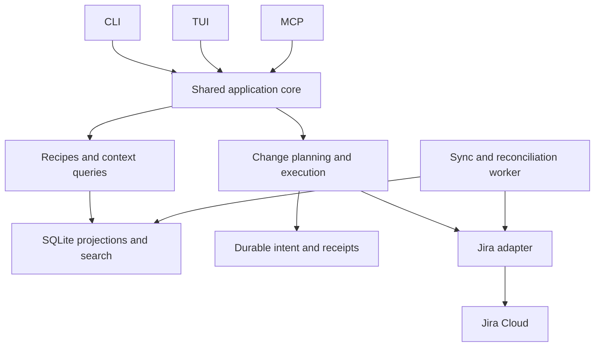

# jai: Product Review and Future Direction

**Date:** 2026-11-10  
**Lenses:** Staff Product Manager; Staff Engineer

## Scope and recommendation

This is a product assessment, **not an implementation-gap review, bug audit, or specification-compliance check**. It evaluates the value of jai's current capabilities, the experience they create, worthwhile product investments, and how I would design the product starting today. Recommendations are proposed product directions, not assertions that the corresponding engineering work is absent.

**Recommendation: deepen jai into a trusted local workspace for understanding and acting on engineering work, rather than broaden it into a terminal replica of Jira.**

The local SQL model is the strongest foundation. The next opportunity is to turn that foundation into repeatable workflows: understand what matters, collect the right context, make a deliberate change, and know what happened. Keep SQL available throughout, but do not require users to become query authors before receiving value.

Three investments deserve priority:

1. **Outcome-oriented entry points:** useful views and workflows that get a new user to a real answer quickly.
2. **Trustworthy decisions and actions:** understandable data freshness, coverage, change previews, and outcomes.
3. **Reusable workflow knowledge:** shareable recipes and bounded context packages that work for humans and agents.

These are strategic judgments. No customer interviews, usage analytics, retention data, or willingness-to-pay evidence were available. User-demand statements below are explicitly hypotheses to validate, not measured findings.

---

# Part I — Staff Product Manager Perspective

## 1. What product is jai really?

The current proposition combines local Jira synchronization, SQL and full-text search, a terminal interface, compact agent output, MCP integration, and write operations. Saved views connect the interfaces; custom-field discovery makes organization-specific Jira data accessible. [S1–S3]

“Query Jira with SQL” is an excellent technical hook. It explains the mechanism clearly. It does not, by itself, tell an engineer why they should return every morning.

I would use two layers of positioning:

- **User promise:** “Understand and act on your Jira work without leaving your development workflow.”
- **Technical proof:** “Local-first queries, reusable views, and precise context for humans and AI agents.”

Do not lead with “replace the Jira web UI.” That creates expectations around administration, rich editing, planning, and every specialized Jira workflow. Browser handoff is a legitimate product boundary, not a failure.

### Choose a primary customer

The original product intent names agents, engineers, managers, and DevOps teams. [S4] That breadth is useful as a market map, but too broad as a prioritization rule.

| Segment | Job to be done | Recommended role |
|---|---|---|
| Engineers already using terminal tools and coding agents | Understand an issue, find related work, update it without breaking development flow | Primary adoption segment |
| Technical leads and release owners | Identify blockers, explain change, prepare a defensible status view | Secondary expansion segment |
| Automation maintainers | Run repeatable Jira workflows with predictable inputs and results | Power-user and reliability segment |
| Managers who mainly consume reports | Receive a clear, shareable answer | Serve through exports and reports; do not require TUI adoption |
| AI agents | Retrieve context and execute authorized operations | Interface consumers, not the customer whose outcomes define the roadmap |

**[HYPOTHESIS]** The strongest initial customer is an engineer who already uses an agent and repeatedly needs Jira context. Validate this against technical leads who do substantial cross-project analysis; they may have a stronger recurring need.

## 2. Where jai can differentiate

Local analysis is meaningfully different from adding another interface to Jira's API. It enables repeated investigation, joins, history analysis, reusable queries, and small selected results without a remote read for each question.

However, “has MCP” and “works with agents” are not sufficient differentiators. Atlassian's official Rovo MCP catalog already documents issue retrieval, search, mutations, metadata discovery, permission groups, and dynamic tool discovery. JiraCLI also explicitly supports interactive terminal workflows and LLM-powered CLI tools. [E1–E2]

| Alternative | Why a user might prefer it | Where jai should compete |
|---|---|---|
| Jira web UI | Full native workflow and administrative context | Less context-switching for repeated engineering tasks |
| Official remote MCP | Direct access to Atlassian capabilities and organization-managed access | Repeated local analysis, reusable workspace context, explicit evidence and bounded results |
| General-purpose Jira CLI | Familiar issue operations and interactive navigation | Cross-issue analysis and shared human/agent workflows |
| Scripts and spreadsheets | Flexible, familiar, easy to customize initially | Reusability, discoverability, consistent semantics, less maintenance |

**[INFERENCE]** jai's defensible advantage is not SQLite alone; another tool can adopt SQLite. It is the combination of a useful local model, portable workflow knowledge, and a trustworthy action experience. Optimize for that combination rather than endpoint count.

## 3. Assessment of the current feature portfolio

These are assessments of product choices, not implementation completeness.

| Capability | Product value | Recommended direction |
|---|---|---|
| Local SQLite and SQL | High analytical ceiling; cheap repeated exploration | Keep as the core and power-user interface |
| Full-text search | Fast retrieval when users do not know an issue key | Make it a main entry point, with understandable matching and context expansion |
| Saved views and snippets | Turn repeated analysis into reusable knowledge | Promote from configuration conveniences to a curated workflow surface |
| TUI | Keeps repeated triage and inspection inside the terminal | Optimize for a small set of complete workflows rather than Jira UI parity |
| CLI and structured output | Composable automation and scripting | Preserve predictable contracts and easy piping |
| MCP and schema discovery | Makes the workspace usable from agent environments | Optimize completed-task cost and correctness, not merely small responses |
| Writes, bulk changes, composite updates, queue | Lets users act on analysis rather than export it elsewhere | Organize around intent, review, execution, and recovery |
| History, dependencies, sprint and optional development information | Supplies the ingredients for richer decisions | Package into explainable answers rather than another field inventory |
| Custom-field discovery | Adapts to real organizations instead of an idealized Jira schema | Make organizational vocabulary reusable and visible |
| Templates, cloning, links, watchers, exports | Useful workflow conveniences | Maintain; add breadth only when it closes an important user journey |

The portfolio already contains substantial capability. The higher-value question is **which user journey becomes substantially easier**, not which additional command can be exposed. [S1–S3]

## 4. Make existing features more effective

### 4.1 Onboarding: reach the first useful answer, not just the first sync

**Current product model:** connect Jira, choose synchronization scope, then query or launch the TUI. [S1, S2]

**Recommended experience:** ask what the user wants to accomplish—my work, team triage, or release review—then choose a suggested scope and show a useful result as early as possible. Explain what is included and what is still loading. Advanced JQL remains available.

Offer a synthetic demo workspace before credentials. It lets users evaluate the interaction model without exposing company data or waiting for an initial download.

**Tradeoff:** downloading broadly reduces future configuration; starting narrowly improves time to value and data minimization. Recommend narrow, explicit initial scope with easy expansion. Do not silently limit a report to recent issues without showing that boundary.

**Success signal:** a new user can answer a real work question without writing SQL or consulting setup documentation. Measure first-value time separately from total sync time.

### 4.2 Queries and views: make SQL the ceiling, not the entrance exam

Preserve raw SQL, but introduce a small number of named workflows with typed parameters: “my open work,” “unowned bugs,” “release blockers,” and “changes since my last review.” Reuse the same definitions in CLI, TUI, and MCP.

A view should expose its purpose, parameters, scope, definition, and relevant freshness—not only a name and result table. Users should be able to inspect the underlying query and save a variation.

Choose between three approaches:

- **Raw SQL only:** least product surface, highest onboarding burden.
- **Curated parameterized recipes:** retains SQL power with a manageable learning curve. **Recommended.**
- **Another full query language or visual dashboard builder:** greater scope and maintenance; defer until specific demand justifies it.

Semantic defaults matter: “active,” “blocked,” “priority,” and “cycle time” must reflect a team's workflow rather than assume universal Jira terminology. This is a product-definition problem even with perfect query execution.

### 4.3 Synchronization: expose a decision contract, not a maintenance chore

jai already offers incremental/full synchronization, stale-data information, wait/skip controls, and reconciliation of silently changing fields. [S1, S2] The product opportunity is to express these capabilities in user language:

- **Browse:** show cached information immediately; make its age visible.
- **Decide:** satisfy a requested freshness requirement or explain why the answer is qualified.
- **Act:** revalidate the specific issues and conditions relevant to the change.

A cached personal task list and a release-readiness judgment should not need the same freshness policy. Nor should a single “synced recently” label imply that every relationship, history range, or field is equally current.

Show both freshness and coverage: “recent” is not synonymous with “complete.” Where arbitrary SQL makes precise scope attribution impractical, report conservative workspace-level coverage rather than invent precision.

**Success signal:** users can correctly answer “what does this result include, and is it current enough for this decision?” without knowing synchronization internals.

### 4.4 Writes: organize around change sets, not command count

SQL-driven bulk operations are unusually powerful because the same tool can find a cohort and change it. [S2] Design the review experience to match that power.

A proposed change set should show the workspace, exact issues, intended field changes, current values, assumptions, and operations that cannot be reversed. Freeze the target set for approval; do not rerun a mutable selection later and silently affect different issues.

Keep low-risk single-issue edits fast. Require more deliberate review as risk grows: large cohorts, transitions, cross-project changes, or content publication. An agent receiving approval should not receive unlimited authority for unrelated writes.

The queue should feel like an **outbox with understandable states**, not an invisible implementation detail. Users need to distinguish drafts, approved deferred work, completed changes, rejected changes, and uncertain outcomes.

**Tradeoff:** confirming every operation adds friction and trains people to ignore prompts. Recommend risk-sensitive review and scoped automation policies, not universal confirmation dialogs.

Make delegation legible through a few profiles: **analyst** can read, **drafting assistant** can propose changes, and **project operator** can execute within an approved scope. Let organizations refine policies underneath those profiles. This is easier to reason about than asking every user to construct an authority model from individual tools.

### 4.5 TUI: optimize the triage loop

The strongest terminal journey is:

**Find work → inspect evidence → choose an action → see the result → move to the next item.**

Evaluate every TUI investment by whether it shortens that loop. Favor contextual actions, typed field choices, an understandable history view, remembered position, and visible action outcomes over elaborate dashboard layouts.

Keep Jira browser handoff for rich or uncommon workflows. A TUI can be an excellent product without reproducing every Jira screen.

**Success signal:** users complete a representative triage session with fewer context switches and no uncertainty about which actions landed. Count actual task completion, not number of keyboard shortcuts.

### 4.6 Agent experience: optimize total task economics

Compact output and field selection are strengths. [S1] Token count alone is an incomplete objective: a response that is too sparse can cause more tool calls, guessing, and retries.

Use progressive disclosure: a concise result, explicit bounds and provenance, then targeted expansion. Offer task-specific context rather than forcing agents to assemble an issue, parent, blockers, selected comments, and relevant history independently every time.

Keep natural-language reasoning in the user's chosen agent. jai should supply reliable retrieval, organizational semantics, and authorized actions—not become another chatbot with its own model account and conversation state.

**Success signal:** lower time, tool calls, and context cost per correctly completed task, with no increase in unsupported conclusions or unintended changes.

## 5. Useful feature investments

These extend existing foundations. They are not a claim that related primitives are missing.

### A. Bounded issue context packages — first candidate

**User job:** “Give me what I need to start this issue or review a proposed fix.”

Package the issue, parent intent, acceptance criteria where identifiable, direct blockers, relevant recent discussion, and linked development references. Include source links, timestamps, scope, and omitted sections. Support expansion rather than silently dropping important material to meet a size limit.

Start with deterministic selection and user-configured sections. Add ranking only after measuring whether it improves relevance. Avoid generated summaries becoming the only preserved evidence.

**Why it fits:** builds directly on issues, relationships, history, custom fields, and agent access. [S2]

**Validation:** compare against manual multi-call context assembly on real engineering tasks; measure missing-context errors as well as cost.

### B. Change-aware review inbox — second candidate

**User job:** “What changed that requires my attention?”

Build on saved views and history to show changes since the user's last acknowledged review: a new blocker, ownership change, newly overdue work, or issue entering/leaving a tracked cohort. Explain why each item appears. Support acknowledge and snooze without changing the Jira issue itself.

This differs from sorting issues by `updated`: it preserves the user's review position and separates meaningful changes from background churn.

**Tradeoff:** it can become another noisy notification system. Begin with a pull-based inbox and a few user-selected change types, not email/Slack delivery everywhere.

**Validation:** users repeatedly return to it and judge surfaced items actionable; high dismissal rates are a reason to narrow it.

### C. Portable workflow packs — third candidate

**User job:** “Give my team the same useful workflows without copying personal configuration.”

Bundle views, typed parameters, field mappings, metric definitions, templates, and optional action policies. Separate shared definitions from personal identity, credentials, and local data. Show compatibility requirements and a readable diff when updating a pack.

Start with local/Git-distributed declarative packs, not a hosted marketplace or arbitrary executable plugins.

**Why it fits:** saved views and snippets already make workflows reusable; packs turn that reuse into a deliberate team adoption path. [S1, S2]

**Validation:** a second team member can adopt a pack without its author debugging their setup, and results retain the intended meaning across projects.

### D. Evidence-backed release and dependency review

**User job:** “What threatens this release, and what changed since the last review?”

Extend dependencies, history, and saved views into a report of unresolved blockers, unowned work, scope additions/removals, and relevant transitions. Every finding should link to evidence and expose missing coverage.

Start with transparent rules and configurable thresholds. Do not present a speculative “release confidence score” as objective truth. Forecasting becomes appropriate only after historical inputs and workflow definitions are trustworthy.

**Validation:** release owners identify meaningful risks faster and can explain the report to another person without reverse-engineering its logic.

### E. Reproducible review snapshots and exports

**User job:** “Share the answer I reviewed, not a moving query result.”

Create a timestamped artifact containing the view definition, parameters, scope, relevant evidence, and result. Compare it with a later snapshot. Build on existing Markdown/CSV/JSON export instead of requiring a new collaboration service.

A snapshot is not proof that Jira was globally consistent at one instant; describe the collection window. Apply redaction and retention policy because exported evidence can outlive Jira access.

**Validation:** two people can discuss the same result and distinguish actual work changes from changed query definitions.

### F. Context-aware retrieval — investigate, do not lead with embeddings

**User job:** “Find related work even when the wording differs.”

First combine existing full-text retrieval with project, type, date, and relationship context. Show why a result matched. Evaluate semantic retrieval only against a representative relevance set and its incremental benefit.

**Tradeoff:** embeddings add indexing, privacy, model choice, and refresh costs. They should earn those costs by finding useful issues that lexical and relationship-aware retrieval miss—not by being an expected AI feature.

## 6. What I would deliberately not prioritize

- **Full Jira UI parity:** scope expands faster than differentiation.
- **An embedded general-purpose chatbot:** duplicates the agent environment while adding model and privacy responsibilities.
- **Autonomous backlog management by default:** increases consequence before proving recommendations are useful.
- **A hosted shared copy of company Jira data:** changes the security and operating model substantially; validate a specific need first.
- **A generic multi-tracker platform:** do not weaken Jira workflow semantics to add superficial integrations.
- **Large plugin or template marketplaces:** prove a small number of reusable workflows before building distribution infrastructure.
- **Broad administrative or destructive operations:** add only where a validated primary workflow requires them.

Attachment handling, worklogs, and sprint administration may be valuable for particular teams. Prioritize them when evidence shows that they repeatedly break a core journey, not because another client exposes them.

## 7. Priorities and evidence gates

This is an outcome sequence, not an implementation backlog or calendar commitment.

| Sequence | Product investment | Evidence required to advance |
|---|---|---|
| 1. Establish the core journey | Role-based first value, useful recipes, visible workspace/freshness, coherent action review | New and existing users complete the chosen journey and understand its data/action boundaries |
| 2. Make the journey repeatable | Context packages and change-aware review | Repeated voluntary use; less context assembly and review effort without reduced correctness |
| 3. Spread the value | Workflow packs and reproducible reports | Adoption by a second person/team without bespoke author assistance |
| 4. Expand selectively | Richer release analysis, retrieval, integrations | A measured bottleneck in retained users' work, not feature requests in isolation |

### Measure outcomes, not activity

**Proposed primary outcome:** retained users repeatedly complete a chosen engineering workflow with less effort and confidence that the answer/action is correct.

Use a small scorecard:

- **Activation:** time from setup start to first useful answer; completion without help.
- **Retention:** repeat completion of the same valuable workflow across subsequent weeks.
- **Effectiveness:** task completion time, browser handoffs, and user-rated usefulness.
- **Trust:** correct interpretation of stale/partial data; unintended changes; unresolved action outcomes.
- **Agent efficiency:** total tool calls, context size, elapsed time, and successful task completion together.
- **Team leverage:** pack reuse and time for a second user to reach value.

Establish baselines before setting numerical targets. For an open-source local-first tool, prefer opt-in local diagnostics and consensual usability studies over collecting issue content or SQL text.

### Research before committing to the larger bets

Observe engineers, agent users, and technical leads performing their actual tasks. Ask them to demonstrate the last time they assembled issue context, investigated a blocker, bulk-edited a cohort, or prepared a status report. Compare jai with their existing workflow using the same task.

Test whether users understand data scope and change previews, not merely whether they like the feature concept. Retain the bets that materially improve repeated work; narrow or abandon those that produce demos but no return usage.

---

# Part II — Staff Engineer Perspective on Product Quality

## 8. Quality is the predictability of the product model

The strongest engineering choice is already present: a local queryable representation with multiple interfaces. Go, SQLite/FTS5, a CLI, and a terminal UI are reasonable foundations for a distributable, low-operations product. [S1, S5]

The central tension is also inherent to the product: a local mirror is fast and available, while Jira remains remote, mutable, permissioned, and authoritative. No amount of implementation polish removes that tension. Quality comes from exposing sensible guarantees and making the boundaries comprehensible.

I would assess quality against these contracts, rather than a code-style score or feature count:

| Quality attribute | User-visible contract | How to evaluate it |
|---|---|---|
| Semantic integrity | A field, workflow state, and metric mean the same thing across interfaces | Representative organizations with different custom fields and workflows |
| Data trust | Results explain origin, scope, age, and material uncertainty | Tasks involving stale, partial, and cross-project information |
| Action reliability | An intent has a traceable outcome; uncertain is not reported as successful | Interrupted, delayed, conflicting, and partially successful action scenarios |
| Interface coherence | CLI, TUI, and MCP express the same underlying operations | Complete the same task through each interface |
| Responsiveness | Common reads stay fast; expensive operations are bounded and cancellable | Small and large workspaces, concurrent reading/sync, slow remote responses |
| Recoverability | Replaceable cache and irreplaceable local intent are treated differently | Cache rebuild, interrupted upgrade, credential change, and restore exercises |
| Privacy and control | Users know where company data resides and what agents may read or change | Workspace isolation, retention, credential, export, and policy reviews |
| Evolution | Saved workflows remain understandable as Jira and jai evolve | Pack/schema upgrades with explicit compatibility and migration behavior |

These are proposed acceptance dimensions, not a claim that the current product fails them. No production reliability or security certification is implied by this review.

## 9. Important engineering tradeoffs

### Local-first should not mean local-authoritative

Treat Jira as authoritative for remote issue state, the local database as an observed projection, and local drafts/review state as separately owned data. The user should never have to infer whether a displayed value is observed remotely, proposed locally, or awaiting confirmation.

Likewise, cached access cannot guarantee immediate revocation when Jira permissions change. A product for stricter environments needs an explicit policy: limited retention, revalidation, purge behavior, and possibly reduced offline availability. State that tradeoff rather than promising both indefinite offline access and immediate remote revocation.

### Flexible fields versus a stable product vocabulary

Jira flexibility is essential, but leaking every raw field distinction into each workflow makes the product harder to use and maintain.

Use a layered model: preserve raw source data; expose typed canonical entities and stable identifiers; provide readable aliases and organization-level mappings. Keep unfamiliar custom fields accessible without requiring all workflows to understand them.

Avoid turning the entire data model into generic key/value records that make common SQL painful. Equally, avoid pretending all organizations share the same statuses, priority order, or metric definitions.

### Rich content versus compact context

Keep source rich content and links as evidence while exposing readable projections for search and agents. A compact representation is a view of the original, not an adequate replacement for every editing task.

Use targeted edits and deliberate replacement semantics. “Round-trip through a summary” should never be a default content-editing model.

### Reliability versus friction

Do not promise universal transactions or exactly-once execution across Jira operations. Some workflows span multiple calls and can partially succeed. Give users a durable receipt with per-step state, safe retry behavior, and a clear route for resolving uncertain outcomes.

Undo should be described as a compensating action where supported, not time travel: posted comments, transitions, and side effects may not be fully reversible.

### Analytical depth versus operating cost

More replicated data is not automatically a better product. Initial download time, recurring Jira requests, local disk usage, and background CPU are costs users pay for depth and freshness. Budget them per workspace purpose: daily work needs a responsive working set; historical analysis needs sufficient history and explicit coverage.

Show phase progress and approximate scope before expensive work, and offer useful results progressively. Evaluate total cost per useful workflow—including retries and repeated context assembly—not just query latency or sync throughput. Avoid precise time estimates when the remote service and data shape make them unreliable.

### Privacy versus convenience

Local storage avoids a new hosted data processor, but company data still lives on disk, in backups, exports, and agent contexts. Maintain separate workspace identities, explicit credential references, deliberate export scope, and redacted diagnostics.

Share workflow definitions by default—not synchronized issue databases. Remote multi-user serving should be treated as a different deployment/security product, not just another transport flag.

---

# Part III — If Building jai from Scratch Today

## 10. Keep the foundation; change the organizing abstraction

I would still choose a single Go binary and SQLite with FTS. I would not start with microservices, a graph database, a vector database, or a mandatory cloud backend.

I would organize the product around four concepts:

1. **Workspace:** identity, Jira site, scope, credentials, semantic mappings, and policies.
2. **Recipe:** a named question or workflow with typed parameters and visible semantics.
3. **Context package:** bounded, attributable evidence for a human or agent task.
4. **Change set:** an explicit intent with targets, preconditions, approval, and durable outcomes.

SQL remains the analytical foundation and escape hatch. The interfaces expose these concepts rather than independently assembling business behavior.

### Architecture

### Main design decisions

| Decision | Choice | Why; cost accepted |
|---|---|---|
| Distribution | Single binary; no required service for ordinary local reads | Easy installation and ownership; local deployment differences still need support |
| Storage | SQLite with raw data, typed projections, relationships, FTS, and durable local intent | Fits local querying; migrations and indexing remain real product responsibilities |
| Identity | Jira site plus immutable issue identity; keys and names as mutable aliases | Preserves relationships and history when display identifiers change |
| Shared behavior | One application core behind CLI/TUI/MCP adapters | Consistent semantics; adapters still optimize presentation for their users |
| Queries | Read-only analytical access, typed recipe parameters, raw SQL escape hatch | Combines safety and flexibility; avoid inventing another full language |
| Freshness | Explicit cached, freshness-constrained, and targeted live behavior | Makes remote cost and uncertainty deliberate |
| Mutations | Durable change sets with scoped policy and per-step outcomes | Makes recovery understandable; more state modeling than direct endpoint wrappers |
| Synchronization | Resumable observation and reconciliation, prioritized by requested scope | Supports progressive usefulness; coverage must be modeled honestly |
| Background lifecycle | An optional managed local worker, not a prerequisite for reading cached data | Reliable background work for frequent users without mandatory daemon setup |
| AI | External agent performs reasoning; jai provides retrieval, evidence, and authorized tools | Avoids owning a second model/conversation product |
| Extensibility | Declarative workflow packs before executable plugins | Lower support and security burden; less arbitrary extensibility |
| Team sharing | Share definitions and redacted artifacts first | Preserves local-first trust; shared live infrastructure remains a separate decision |

### Interaction design

A human starts with a useful recipe, inspects the evidence, and proposes an action. An agent follows the same path with structured results. Both see the same workspace, data boundaries, and operation outcomes.

The proposed lifecycle is:

**Observe → understand → propose → authorize → execute → reconcile.**

Not every interaction needs six visible screens. A safe single-issue change can compress the flow; a large automated update should expose it. The underlying meaning must remain consistent.

### Design for recovery from the beginning

Separate rebuildable Jira projections from non-rebuildable local data: drafts, queued intent, approvals, review acknowledgements, and workflow configuration. A cache reset must not imply discarding user work.

Use stable identifiers, versioned public contracts, and explicit schema migration policies. Resource budgets should be designed into expensive queries and context expansion, with truncation made visible. Keep diagnostics useful without logging issue bodies, tokens, or private query values by default.

## 11. What I would build first—and what I would postpone

Start with one complete journey: **understand my work, inspect one issue with its immediate context, and make one deliberate update with an unambiguous outcome**.

Deliver a useful local view, a recipe surface, evidence-aware context retrieval, and shared action semantics. Make CLI and MCP first-class; give the TUI a deliberately narrow triage role rather than an independent feature roadmap.

Then prove a second journey: **review what changed across a team or release and share the evidence**. Only after those journeys are repeatedly useful would I expand analytics, semantic retrieval, or integrations.

For the existing product, this is **not a recommendation to rewrite**. Preserve the working capabilities and evolve the shared concepts behind them. Use the greenfield design as a decision guide: invest where it improves a user outcome, not merely where it makes an architecture diagram cleaner.

## Final judgment

jai has a strong technical premise and a broad enough feature base to support valuable engineering workflows. The next product advantage should come from coherence, not breadth:

- Get users to useful answers without requiring SQL expertise.
- Make data boundaries and action outcomes understandable.
- Turn individual queries into reusable team workflows.
- Give agents the right evidence, not simply fewer tokens.
- Preserve local-first ownership without hiding its tradeoffs.

**The product to build is not “Jira, but in a terminal.” It is a trustworthy engineering workspace that makes Jira information easier to use and Jira changes easier to control.**

---

## Sources and review limits

### Repository sources

- **S1 — [README](../README.md):** product positioning and local SQL (`23–33`); agent/MCP surfaces (`227–288`); shared views (`292–345`); writes (`350–445`); configuration and commands (`449–572`).
- **S2 — [User guide](user-guide.md):** read workflows (`33–134`); mutations (`138–320`); dependencies (`350–365`); synchronization and metadata (`369–434`); agent/MCP interfaces (`438–502`).
- **S3 — [Prior feature-adoption strategy](jira-cli-feature-adoption.md):** database-first, agent-oriented, shared-view principles (`6–16`) and differentiation (`365–386`). Historical proposals were not treated as the current feature inventory.
- **S4 — [Original product idea](idea.md):** audience and intended value (`3–27`). Historical architectural choices were not assumed to remain current.
- **S5 — [Current dependencies](../go.mod):** Go, Bubble Tea, Cobra, MCP, and SQLite/FTS foundation (`3–14`).

### External primary sources

- **E1 — [Atlassian Rovo MCP: supported tools](https://developer.atlassian.com/cloud/rovo-mcp/guides/supported-tools/):** official tool catalog, discovery model, and permission groups; accessed 2026-11-10. Used to assess positioning, not to claim measured performance parity.
- **E2 — [JiraCLI repository and product documentation](https://github.com/ankitpokhrel/jira-cli):** interactive Jira workflows and agent-tool positioning; accessed 2026-11-10. No hands-on competitor benchmark was performed.

### Method and limits

Reviewed product documentation, prior product direction, and selected architecture/interface sources to understand the product model. Built an isolated current-source binary and observed `jai --help` to confirm the command surface. No live Jira data was accessed or changed for this review. No usability study, production performance benchmark, interactive TUI evaluation, or live MCP workflow evaluation was performed. Implementation defects and spec deviations were deliberately excluded following the requested scope clarification.

The recommendations are therefore an evidence-informed strategy and quality framework—not proof of customer demand or a production-readiness rating.
