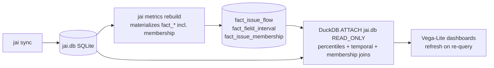

# Flow-Metrics Visualization Plan

**Goal:** make every flow-metrics signal explorable by **absolute value**, by
**time window** (month / quarter / year / arbitrary range), and by **dimension**
(component, label, type, priority, assignee, team, sprint, …) — with Linear-grade
charts — without bloating `jai`.

**Principle (revised after validation, 2026-11-12):** `jai` stays thin and owns
the two things external tools cannot reproduce: **event-time attribution** and
the **percentile/cohort engine's facts**. Charts read the **live** `jai.db`
through DuckDB; no CSV round-trip. The only new persistence `jai` needs is
**set-valued membership facts** (components/labels/sprint), the single piece of
event-time state not already on disk.

Grounding: the full `jai metrics` engine exists and is correct — ROX cycle p95
130.9, lead p95 383.7, bug:feature 1.88, all reconciled against DuckDB reading
the fact tables directly (see §4).

---

## 1. What we have today — 24 live metrics

All are registered providers in `internal/metrics` (`jai metrics list`), computed
by one shared `Service` over fact generations, with event-time attribution,
genuine-delivery cohorts, and canonical stage mapping baked in. Grouped by output
shape (which drives the chart type):

### Distributions (percentiles p50/p85/p95; scatter- or histogram-ready)

| Metric | Measures | Cohort / basis |
|---|---|---|
| `cycle_time` | first active-stage entry → resolved | genuine-done; excludes `no_active_start` |
| `lead_time` | created → resolved | genuine-done |
| `flow_occupancy` | active ÷ lead (proxy, bounded [0,1]) | delivered, lead>0 |
| `triage_latency` | created → first assignment/comment | all in scope |
| `stage_dwell` | time-in-stage (WIP bottleneck) | all stages, aged to `as_of` |
| `blocker_ageing` | dependency-link age (proxy) | currently linked/waiting |
| `security_sla` | remediation time + compliance buckets | security types; config deadlines |
| `reopen` | reopen-count histogram + rate | all / completed denominator |
| `priority_changes` | priority-change count per issue | all (direction unavailable) |
| `rank_volatility` | Rank-change count per issue | all (requires Rank tracked) |
| `reassignment_count` / `reassignment_thrash` | assignee-change count per issue | all |

### Counts / mix (bar-ready)

| Metric | Measures |
|---|---|
| `resolution_mix` | resolution distribution among resolved (`(none)` surfaced) |
| `aged_open` | age buckets for open issues (status category ≠ done) |
| `ratio` | configurable class ratio (bug:feature) over a cohort |
| `sprint_resolution` | per-sprint eventual resolution of ever-members |
| `workload_by_assignee` | current open item-load per owner |
| `workload_throughput` | completed per **owner-at-completion** (event-time) |
| `workload_throughput_current` | completed per **current** owner |
| `workload_time_on_owner` | event-time days held per owner |

### Time series (line / area / burn-up)

| Metric | Measures |
|---|---|
| `throughput` | completed per period (month/week) |
| `net_flow` | created vs resolved per period |
| `wip` | daily WIP count (reconciled vs snapshot) |
| `cfd` | daily cumulative flow across all stages (= burn-up) |

Plus `jai metrics coverage` — data-coverage diagnostics (not a chartable metric).

**Note:** this already **exceeds** Linear's six measures — it adds flow
occupancy, stage dwell, reopen/churn, SLA, sprint resolution, net-flow, WIP, and
event-time workload variants.

---

## 2. What we want to visualize — target catalog (Linear ∪ Jira)

The target is Linear Insights parity on measures/dimensions/charts, plus the
Jira-specific fields and jai-specific metrics above. Legend: ✅ have / can do
(often **better**), ⚠️ partial / config- or data-dependent, ❌ cannot (reason).

### 2a. Measures

| Linear measure | jai | Verdict |
|---|---|---|
| Issue count | `throughput` / `net_flow` / any `count(*)` | ✅ |
| Cycle time | `cycle_time` (stage-based, event-time, excludes no-active-start) | ✅+ |
| Lead time | `lead_time` | ✅ |
| Triage time | `triage_latency` (created→first response) | ✅ (def differs from "dwell in Triage status") |
| Issue age | `aged_open` | ✅ |
| Effort (Σ estimate) | `sum(estimate)` | ⚠️ needs story points; **absent across ROX** |
| — | **extras:** flow_occupancy, stage_dwell, reopen, churn, SLA, workload, WIP | ✅ beyond Linear |

### 2b. Dimensions (slice + segment)

Attribution mode matters: ✅+ = we can serve the **event-time** value (value in
effect at completion), which Linear's non-burn-up insights cannot.

| Dimension | Source | Verdict |
|---|---|---|
| Status | status interval (event-time) / snapshot | ✅+ |
| Status type / stage | canonical `status_stage` map | ✅+ |
| Assignee | assignee interval (event-time) | ✅+ |
| Priority | priority interval (event-time) | ✅+ |
| Creator / reporter | issues snapshot | ✅ |
| Label | membership (event-time) — **needs persistence (§5)** | ✅+ |
| Component | membership (event-time) — **needs persistence (§5)** | ✅+ |
| Sprint / cycle | membership (event-time) — **needs persistence (§5)** | ⚠️ JQL-only, no real cycle dates |
| Team | Team field (event-time if tracked) | ✅ |
| Project | `project` | ✅ |
| Estimate | estimate value | ⚠️ data-dependent |
| SLA status | `security_sla` breach buckets | ⚠️ config deadlines |
| Initiative | Epic Link / parent hierarchy | ⚠️ no native "initiative" |
| Created / Completed / Started / Due date | `created` / `resolved` / `first_active_at` / `duedate` | ✅ (`started` reconstructed) |
| Canceled date | resolutiondate on non-delivery resolution | ⚠️ |
| Label group / Project label / Project label group | — | ❌ Jira has no such concept |
| Template | — | ❌ not synced |
| External source | — | ❌ no structured field |

### 2c. Time-series grouping

| Grain | Verdict |
|---|---|
| Daily / Weekly / Monthly / Quarterly / Yearly | ✅ all — DuckDB `date_trunc` / derived keys over the live DB |

(The CLI stays month/week; the grain is a view concern, not an engine concern.)

### 2d. Chart types

| Chart | Source | Verdict |
|---|---|---|
| Segmented bar (count, effort) | counts metrics | ✅ |
| Scatterplot w/ 25/50/75/95 markers | distribution metrics (per-issue points + DuckDB percentiles) | ✅ |
| Burn-up / CFD (historical) | `cfd` | ✅ |
| Line / stacked area | `throughput`, `net_flow`, `wip` | ✅ |

### 2e. Display / interactivity

| Interaction | Verdict |
|---|---|
| Hover tooltip; full-screen; export CSV | ✅ |
| Scatter point → open the Jira issue (link via `issue_key`) | ✅ |
| Select bar/segment → cross-filter the dashboard | ⚠️ Vega selection (filters charts, not a live issue view) |
| Percentile zoom; table cross-highlight | ⚠️ buildable, effortful |
| Share link (live, permissioned) | ⚠️ host a static page; no per-user ACL |
| Real-time refresh; in-app bulk action | ❌ Linear's turf — different product (see §6) |

---

## 3. The architecture — live DuckDB over `jai.db`

Charts query the **live** database; no export-and-import step.



**Three data surfaces, all in one SQLite file:**
- `issues` — current snapshot (every Jira field, for current-attribute dims and filters).
- `fact_issue_flow` — one row per issue: lead/cycle/occupancy inputs, flags, timestamps.
- `fact_field_interval` — event-time intervals for `status, priority, assignee, Rank`.
- **`fact_issue_membership` (new, §5)** — event-time intervals for `components, labels, Sprint`.

**Why DuckDB and not `jai query` alone:** SQLite has **no `median` /
`percentile_cont`** (verified: `no such function: median`). The headline signals
are p50/p85/p95 distributions, so an analytical engine is required. DuckDB
**attaches the live SQLite** (read-only) and runs percentiles, temporal joins,
and pivots directly:

```sql
INSTALL sqlite; LOAD sqlite;
ATTACH '~/.local/share/jai/jai.db' AS jai (TYPE sqlite, READ_ONLY);

-- event-time priority at completion, p95 cycle — reconciles to jai metrics exactly
SELECT iv.value AS priority, count(*) n,
       round(quantile_cont(f.cycle_seconds/86400.0, 0.95), 1) p95
FROM jai.fact_issue_flow f
JOIN jai.fact_field_interval iv
  ON iv.generation=f.generation AND iv.issue_key=f.issue_key AND iv.field='priority'
 AND iv.entered_at <= f.resolved AND (iv.exited_at IS NULL OR iv.exited_at > f.resolved)
WHERE f.generation=(SELECT generation FROM jai.metrics_active_generation WHERE id=1)
  AND f.cycle_seconds IS NOT NULL AND f.resolution IN ('Done','Done-Errata')
GROUP BY priority ORDER BY n DESC;
```

**"Live" means:** as fresh as the last `metrics rebuild` + sync — not
real-time-on-read. Event-time reconstruction (replaying every changelog) is too
expensive per query, so it is materialized into a fact generation (≈4s for ROX,
patched incrementally). This is the correct tradeoff and the honest boundary vs
Linear's real-time model.

---

## 4. The only `jai` change — persist membership facts

Set-valued fields (components, labels, Sprint) are the one event-time surface not
on disk: `fact_field_interval` holds only scalar fields, and membership is
reconstructed on demand by `ReplayMembership` ("no second persistence schema" —
`membership.go`). To make component/label drill live-queryable, persist it like
the scalar intervals.

**Add `fact_issue_membership`** (mirrors `fact_field_interval`):

```
(generation, issue_key, project, dimension, member_id, member_name,
 entered_at, exited_at, is_open)
```

- `dimension` ∈ {`component`, `label`, `sprint`} (driven by a `membership_fields`
  policy entry; the engine already knows the set-valued field names via
  `IsSetValuedField`).
- Written inside `writeFacts` during `metrics rebuild`/incremental, by running
  `ReplayMembership` per issue (the exact logic the validated prototype used).
- Event-time drill is then a pure SQL temporal join, fan-out-safe (one row per
  `(issue, member, interval)`; `GROUP BY member_name` never double-counts a
  single issue's measure):

```sql
SELECT m.member_name component, count(*) n, round(median(f.lead_seconds/86400.0),1) p50
FROM jai.fact_issue_flow f
JOIN jai.fact_issue_membership m
  ON m.generation=f.generation AND m.issue_key=f.issue_key AND m.dimension='component'
 AND m.entered_at <= f.resolved AND (m.exited_at IS NULL OR m.exited_at > f.resolved)
WHERE f.resolution IN ('Done','Done-Errata') AND f.lead_seconds IS NOT NULL
GROUP BY component HAVING count(*)>=50 ORDER BY p50 DESC;
```

This is the whole engine change. Everything else (measures, cohorts, time
windows, event-time priority/assignee/status, all 24 metrics) is **already**
live-queryable.

**Optional, lower priority:**
- `flow_occupancy` as a persisted column or a SQL view over status intervals
  (precompute to avoid a windowed aggregation per query).
- `estimate` column on `fact_issue_flow` to enable the Effort measure where story
  points exist (no-op for ROX).

**Explicitly not building:** a CSV/Parquet export command as the query path (the
attach supersedes it). A Parquet snapshot (`COPY … TO`) stays available as a
one-liner for portability / warehouse hand-off only.

---

## 5. The dashboard — one live, interactive surface (hosted in-repo)

`jai metrics dashboard` becomes **live and interactive**, replacing today's static
export. Decisions folded in here: interactive supersedes static; ship a
**batteries-included** default set covering every metric we can; generic specs in
repo, custom specs local.

### 5.1 How it works (confirming the model)

Close to the comment's mental model, with one correction: the browser cannot call
DuckDB directly (sandbox). So `jai` runs a tiny local server and the page's JS
calls **that**, which runs DuckDB in the background over the live DB:

```
browser (JS, dropdowns)  ──fetch /q?measure=…&slice=…&project=…──▶  jai localhost server
                                                                       │ duckdb -json
                                                                       ▼  ATTACH jai.db (READ_ONLY)
                         ◀──────────────── JSON rows ───────────────  fact_* + issues
```

- **Same single HTML page**, served by `jai` (not opened as a `file://`, so its JS
  may fetch from the local server). Vega-Lite is **vendored** (no CDN).
- Changing **any** control — including **project** — re-queries live; nothing is
  pre-baked or exported. This is exactly the dynamic project selection today's
  static file lacks.
- `jai` holds one persistent DuckDB process with `jai.db` attached (lower latency
  than a subprocess per query); the `/q` endpoint is **read-only, SELECT-only, and
  parameterized** from a fixed SQL template + whitelisted column/measure names —
  never raw client SQL, so there is no injection or write surface.
- **"Live" = freshness of the last `metrics rebuild` + sync** (§3); a *Refresh*
  button can trigger an incremental rebuild.
- Keeps `jai` thin: shelling to / embedding one DuckDB process, no vendored
  multi-MB wasm blob. The one dependency is `duckdb` on `PATH`; the command
  detects it and prints the install hint if missing.

> Alternative considered and rejected: DuckDB-Wasm in the browser (JS calls DuckDB
> *literally* in-page). It needs the data shipped/served as Parquet and a multi-MB
> wasm bundle, reintroducing the export we removed. The local-server path keeps
> data live in `jai.db`.

### 5.2 Controls (the Linear-style knobs from §2)

Top control bar: **dashboard** selector + **measure / slice / segment /
time-grain / project / date-window / cohort** dropdowns. The **project** dropdown
offers the projects present in the active fact generation — so the default rebuild
for dashboard use is **all-projects** (`jai metrics rebuild`, no `-p`); scope with
`-p` only to shrink. Changing a control rebuilds the SQL template and re-renders.

### 5.3 Batteries-included default dashboards

Ship generic coverage for **every metric we have** (§1) and every feasible
measure × dimension (§2) — not a token few — so a fresh install is useful with
zero configuration. Default dashboards (declarative specs, embedded under
`internal/metrics/dashboard/specs/`):

| Dashboard | Panels (all driven by the shared `/q` templating) |
|---|---|
| **Delivery** | `cycle_time`, `lead_time`, `flow_occupancy`, `triage_latency` — distribution + scatter, sliceable by priority/type/component/assignee |
| **Flow** | `cfd` (burn-up), `wip`, `throughput`, `net_flow`, `stage_dwell` |
| **Quality / churn** | `reopen`, `priority_changes`, `rank_volatility`, `reassignment_count`/`thrash`, `resolution_mix`, `ratio` |
| **Backlog & SLA** | `aged_open`, `blocker_ageing`, `security_sla` |
| **Workload** | `workload_by_assignee`, `workload_throughput` (event-time), `workload_throughput_current`, `workload_time_on_owner` |
| **Sprints** | `sprint_resolution` (+ membership-sliced delivery) |

Every panel inherits the control bar, so each metric is explorable across all
dimensions/windows it supports; unavailable/unconfigured metrics render as
explicit "unavailable" cards (the existing graceful-degradation pattern), never
fabricated.

### 5.4 Custom dashboards (local)

Dashboards are **declarative specs** (`{title, measure, slice, segment, chart,
defaults}`), not code. Custom specs load at runtime from a local dir
(`./.jai/dashboards/` then `~/.config/jai/dashboards/`) and appear in the
dashboard dropdown beside the generic ones. Copy a generic spec, tweak, reload —
no rebuild.

### 5.5 Shareable snapshot (the one thing interactive can't do)

A running server is not a file you can email. The existing self-contained
renderer (inlined JSON, pure-SVG, offline, no deps) is **repurposed**, not
deleted, as `jai metrics dashboard --snapshot out.html`: freeze the current view
to a portable artifact for stakeholders without `jai`/`duckdb`. The live server is
the default; the snapshot is an export of it.

### 5.6 Also available (no new code)

Ad-hoc analysis: `duckdb -ui`, a notebook, or any BI tool with the SQLite/DuckDB
connector pointed at `jai.db`.

---

## 6. Non-goals (Linear's turf — different product, not a gap)

- **Real-time / live-on-read refresh** — jai is snapshot at `as_of`.
- **In-app bulk action** on filtered issues — the dashboard is read-only;
  mutations go through `jai set` / MCP separately.
- **Managed, permissioned, multi-user dashboards** — we produce shareable static
  pages / live DB connections, not an access-controlled SaaS surface.
- **Dimensions with no Jira data** — label groups, project labels, templates,
  external source.

---

## 7. Build order

1. **Engine:** add `fact_issue_membership` + schema migration; replay & persist
   set-valued fields in `writeFacts`; add `membership_fields` policy (default
   `[components, labels, Sprint]`). Include the dimension in the generation
   fingerprint so a config change restates it.
2. **Verify:** rebuild ROX; reconcile a membership drill (component lead p50) and
   a scalar drill (event-time priority cycle p95) in DuckDB against the Go
   providers — numbers must match (the prototype already proved they do).
3. **Interactive dashboard (§5.1):** make `jai metrics dashboard` live by default —
   embedded localhost server, persistent DuckDB process attached to `jai.db`,
   vendored Vega SPA, read-only parameterized `/q` endpoint; control-bar dropdowns
   (measure/slice/segment/grain/**project**/window/cohort). Detect missing `duckdb`
   with an install hint. Default dashboard-use rebuild is **all-projects**.
4. **Batteries-included specs (§5.3):** declarative panel specs covering **all**
   feasible metric × dimension combos; embed the default dashboard set under
   `dashboard/specs/`; load custom specs from the local dir.
5. **Repurpose static as snapshot (§5.5):** demote the existing self-contained
   renderer to `jai metrics dashboard --snapshot out.html` (freeze current view);
   remove the old static default path.
6. **Optional:** persist `flow_occupancy` / `estimate`; `attach.sql` convenience
   views for notebook/BI users; a `COPY … TO parquet` snapshot for warehouse
   hand-off.
7. **Promote config:** move the reviewed `metrics:` block (status→stage,
   `done_resolutions`, real SLA deadlines) into `~/.config/jai/config.yaml`.

---

## 8. Caveats (bind every chart)

- **Config-dependent:** figures depend on the `metrics:` block (status→stage map,
  `done_resolutions`, security deadlines). The ROX block used for validation is
  **inferred, not owner-reviewed** — a prerequisite before any number is trusted.
- **Snapshot basis** (current resolution), not an event flow model.
- **Priority drill is Undefined-dominant** (1,644 ROX security issues carry no
  real priority).
- **No real sprint/cycle dates** (JQL-only membership) — sprint signal is eventual
  resolution, not velocity/commitment.
- **Story points absent** across the ROX cohort — prefer count-based measures;
  Effort is data-dependent.
- `sync.dev_info` disabled → no PR cycle time; "any-history" coverage counts
  issues with *some* changelog, not every transition.

---

## 9. Decisions (locked)

| Decision | Choice |
|---|---|
| Query path | **DuckDB `ATTACH` the live `jai.db`** (read-only) |
| Why not `jai query` | SQLite has no percentile functions |
| Engine change | **Persist `fact_issue_membership`** (the only non-live-queryable dim) |
| Attribution mode | **Event-time** (value in effect at completion) via temporal joins |
| Multi-valued dims | **Interval long table**, fan-out-safe `GROUP BY member_name` |
| Charts layer | **Vega-Lite** (vendored, no CDN) |
| Dashboards | **Live interactive by default** — `jai metrics dashboard` serves a localhost SPA; JS → `/q` → persistent DuckDB on live `jai.db`; dynamic dropdowns incl. project |
| Static dashboard | **Removed as default**; repurposed as `--snapshot out.html` (portable frozen artifact) |
| Default coverage | **Batteries-included** — generic specs for every feasible metric × dimension |
| Dashboard defs | **Declarative specs** — generic embedded in-repo, custom from a local dir |
| Dashboard hosting | Embedded under `internal/metrics/dashboard/`, reached only via the `dashboard` subcommand |
| File export | **Parquet snapshot, optional** — portability/warehouse only, not the query path |
| First scope | **ROX** |
